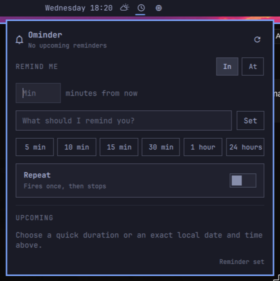

# Ominder

Ominder is an Omarchy Quattro bar widget for creating and reviewing lightweight reminders. It uses Omarchy's native `omarchy reminder` command, so reminders fire through the standard desktop notification system.



## Current features

- Create a reminder with a duration or an exact local date and time, plus an optional message.
- Use quick presets for 5, 10, 15, 30, or 60 minutes, or 24 hours.
- Flip **Repeat** on to keep a reminder firing on its interval.
- See upcoming reminders and their remaining time.
- Stop an individual repeat, or clear every reminder at once.
- Open the panel from the bar or through shell IPC.

The **In** mode passes a whole-minute duration straight to `omarchy reminder`.
The **At** mode accepts `YYYY-MM-DD` and `HH:MM`, validates them in the local
timezone, and converts the selected time to the whole-minute duration that the
underlying command requires. Exact-time reminders never fire before the chosen
minute, but can arrive less than one minute after it. Interval-based repeating
is available in **In** mode only.

## Requirements

- Omarchy 4 / Quattro shell
- The built-in `omarchy reminder` command

## Install

Install Ominder from GitHub and enable its bar widget:

```bash
omarchy plugin add https://github.com/sahzudin/ominder.git --enable
```

If you want to choose its bar placement explicitly:

```bash
omarchy plugin enable io.github.sahzudin.ominder center
```

## Local development

Validate the source folder first:

```bash
omarchy plugin validate .
npm test
```

The [official Omarchy plugin guide](https://omarchyplugins.com/develop.html) loads development plugins from `~/.config/omarchy/plugins/<plugin-id>/`. Copy this checkout there while developing. The plugin ID is:

```text
io.github.sahzudin.ominder
```

After discovery, enable it with:

```bash
omarchy plugin enable io.github.sahzudin.ominder center
```

Open and close the panel without clicking the bar:

```bash
omarchy-shell shell summon io.github.sahzudin.ominder '{}'
omarchy-shell shell hide io.github.sahzudin.ominder
```

Saved plugin files are hot-reloaded. If discovery needs to be forced:

```bash
omarchy-shell shell rescanPlugins
```

## Remove

```bash
omarchy plugin remove io.github.sahzudin.ominder
```

Ominder intentionally has no `install.sh`: installation does not add rows to
the shared Omarchy menu, edit `shell.json` directly, install hooks, or create
plugin-owned artifacts outside its plugin directory. The standard removal
command disables the bar widget and removes the plugin directory, leaving no
Ominder-owned menu rows or commands behind.

Reminders already created through Ominder are user data owned by Omarchy's
built-in reminder service. Removing the UI plugin does not cancel them; they
remain visible through `omarchy reminder show` and fire normally.

Repeat rules are the one file Ominder keeps outside its plugin directory. They
are user data too, and `omarchy plugin remove` leaves
`~/.local/state/ominder/repeating.json` in place; with no widget running,
nothing re-arms from it. Delete the file to discard those rules:

```bash
rm -f "${XDG_STATE_HOME:-$HOME/.local/state}/ominder/repeating.json"
rmdir --ignore-fail-on-non-empty "${XDG_STATE_HOME:-$HOME/.local/state}/ominder"
```

## Repeating reminders

`omarchy reminder` only arms one-shot timers, so recurrence is Ominder's own
bookkeeping rather than a flag passed through to the command. Turning **Repeat**
on stores a rule in `$XDG_STATE_HOME/ominder/repeating.json` (falling back to
`~/.local/state/ominder/repeating.json`); each time that reminder fires, the bar
widget arms the next one with a plain `omarchy reminder` call. Every reminder
Ominder creates is therefore an ordinary Omarchy reminder, visible to
`omarchy reminder show` like any other.

Two consequences follow from that design:

- Rules only advance while the Quattro shell is running. An occurrence due
  during a reboot is skipped rather than replayed, and the schedule resumes at
  the next one.
- Each rule keeps a fixed anchor and measures every re-arm against it, so the
  rounding to whole minutes that `omarchy reminder` requires stays within about
  half a minute instead of accumulating.

Clearing reminders from Ominder also drops the rules behind them. Clearing them
elsewhere — `omarchy reminder clear`, or the built-in reminders panel — leaves
the rules with no armed timer; Ominder notices on its next poll and retires
them rather than re-arming behind your back.

## Architecture

`manifest.json` declares one `bar-widget` entry point. `BarWidget.qml` owns the bar button and loads `Panel.qml` internally, matching the official Quattro plugin contract. No second Quickshell process is started.

`Model.js` holds the pure logic — parsing `omarchy reminder show --json`,
validating exact local timestamps, converting them to durations, and planning
which repeat rules are due — so it is tested under Node without a shell.
`test/model-test.js` covers those paths.

The removal policy is covered by `test/removal-policy-test.js`. If a future
version adds an installer, the test requires a paired uninstaller and checks
that every known shared Omarchy configuration target is handled symmetrically.

## License

MIT
